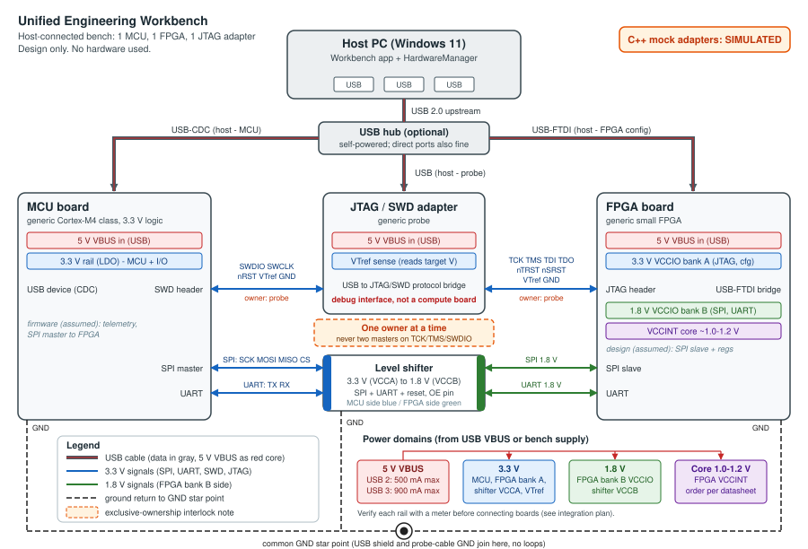

# Task E: Embedded hardware integration design

Unified Engineering Workbench, PASS Science Works R&D internship.

## 1. Purpose and scope

This document describes how a Windows 11 host running the Workbench could be connected to one MCU board, one FPGA board and one JTAG/SWD adapter. It is a **design study only**:

- No hardware was bought, wired or tested. All voltages, currents and pin assignments are generic or illustrative.
- The three devices that appear in the Workbench UI are **C++ mock adapters, labelled SIMULATED** everywhere (UI, API responses, log lines).
- The goal is to show that the interfaces, voltage domains and ownership rules are understood, and that the software is structured so a real driver could replace the mock later.

## 2. Block diagram

Reading the diagram: gray lines with a red core are USB cables (data plus 5 V VBUS). Blue lines are 3.3 V signals, green lines are 1.8 V signals (FPGA bank B side of the level shifter). Dashed black lines are ground returns to a single star point. The orange box is the JTAG ownership rule (section 5).

## 3. Interface and pin/voltage table

"Owner" means the side that drives the signal (or sources the supply).

| Link / signal | From → To | Connector | Voltage domain | Level shifting | Direction / owner | Notes |
|---|---|---|---|---|---|---|
| VBUS | Host/hub → MCU, FPGA, probe | USB cable (e.g. Type-A to micro-B/Type-C) | 5 V | none | Host or hub sources | 500 mA per USB 2 port, 900 mA per USB 3 port. Each board makes its own rails from it. |
| 3.3 V rail | Board LDO → MCU, FPGA bank A, shifter VCCA | on-board | 3.3 V | n/a | Each board owns its rail | Rails of different boards are **never** tied together. Only GND and signals cross between boards. |
| 1.8 V rail | FPGA board regulator → FPGA bank B, shifter VCCB | on-board / 1 wire to shifter | 1.8 V | n/a | FPGA board | Shifter VCCB must come from the same rail as bank B, so the two always agree. |
| VCCINT (core) | FPGA board regulator → FPGA core | on-board | ~1.0–1.2 V | n/a | FPGA board | Sequencing per FPGA datasheet (section 4). |
| GND | all ↔ all | USB shield, cable GND pins, probe-cable GND pins | 0 V | n/a | shared | One star point, no loops (section 4). |
| USB-CDC (D+/D−) | Host ↔ MCU | USB | USB signalling | none | Host is master | Appears as a virtual COM port. |
| USB-FTDI | Host ↔ FPGA board | USB | USB signalling | none | Host is master | On-board USB-serial/FTDI-style bridge for configuration and UART. |
| USB (probe) | Host ↔ JTAG adapter | USB | USB signalling | none | Host is master | Debug traffic only. |
| SPI SCK | MCU → FPGA | 2.54 mm header / jumper wire | 3.3 V → 1.8 V | shifter, MCU→FPGA | MCU (master) | A 3.3 V output would exceed what a 1.8 V bank tolerates, so there is no direct connection. |
| SPI MOSI | MCU → FPGA | same | 3.3 V → 1.8 V | shifter, MCU→FPGA | MCU | |
| SPI MISO | FPGA → MCU | same | 1.8 V → 3.3 V | shifter, FPGA→MCU | FPGA | Must be high-Z when CS is high. |
| SPI CS (nCS) | MCU → FPGA | same | 3.3 V → 1.8 V | shifter, MCU→FPGA | MCU | Active low. Pull-up on the 1.8 V side so a reset or unpowered MCU does not select the FPGA. |
| UART TX / RX | MCU TX → FPGA RX, FPGA TX → MCU RX | same | 3.3 V ↔ 1.8 V | shifter, one channel per direction | Each side drives its own TX | TX/RX are crossed. Idle level is high. |
| Level-shifter OE | MCU GPIO (or pull-up) → shifter | on-board | 3.3 V | n/a | MCU | Outputs off until both rails are up. |
| MCU nRST | Probe → MCU | SWD header | 3.3 V | none | Probe, open-drain | Optional. Pull-up on the MCU board. |
| FPGA nSRST / PROG | Probe → FPGA | JTAG header | 3.3 V (bank A) | none | Probe, open-drain | Meaning is board-specific (check the schematic). |
| JTAG TCK | Probe → FPGA | 2×5 header | 3.3 V (bank A) | none | Probe | Only one master drives TCK (section 5). |
| JTAG TMS | Probe → FPGA | same | 3.3 V (bank A) | none | Probe | |
| JTAG TDI | Probe → FPGA | same | 3.3 V (bank A) | none | Probe | |
| JTAG TDO | FPGA → Probe | same | 3.3 V (bank A) | none | FPGA | |
| JTAG nTRST | Probe → FPGA | same, if present | 3.3 V (bank A) | none | Probe | Often absent. Optional TAP reset. |
| SWD SWDIO | Probe ↔ MCU | 10-pin SWD header | 3.3 V | none | Probe drives, MCU answers (bidirectional) | Shares a pin with JTAG TMS on many parts. |
| SWD SWCLK | Probe → MCU | same | 3.3 V | none | Probe | Shares a pin with TCK. |
| VTref | Target → Probe | JTAG/SWD headers | 3.3 V | none (sense only) | Target sources, probe only reads | Probe sets its output level to VTref. Draws almost no current. A wrong or missing VTref means do not connect. |

Design choice worth noting: the FPGA JTAG pins are in the 3.3 V bank A, so the probe needs **no** level shifting at all. Only the MCU-FPGA data link crosses from 3.3 V to 1.8 V, which is why the shifter sits between those two boards and not on the debug path.

## 4. Pinout assumptions and power/grounding

### Pinout assumptions (generic)

**All pin numbers and net names are placeholders. Verify them against the actual board schematics before wiring anything.**

- SWD header on the MCU board: assumed to follow the common 10-pin 1.27 mm Cortex debug layout: 1 VTref, 2 SWDIO/TMS, 3 GND, 4 SWCLK/TCK, 5 GND, 6 SWO/TDO, 7 key, 8 NC/TDI, 9 GND-detect, 10 nRESET.
- FPGA JTAG header: assumed 2×5 at 2.54 mm with TCK, TMS, TDI, TDO, VREF, GND and optional nSRST. The real order varies by vendor.
- SPI/UART between boards: four SPI wires plus two UART wires plus GND, on jumper wires to the shifter. FPGA pin names ("IO_B_xx") and MCU pin names are not decided here.
- Probe-side connector: whatever the probe ships with (ribbon to 10-pin). Adapters may be needed.

### Power and grounding

- **USB budget.** USB 2 ports supply up to 500 mA, USB 3 up to 900 mA, per port. Rough guesses (not measured): MCU board 50–100 mA, FPGA board 150–300 mA, probe under 100 mA. Plug each board into its own port (or a **powered** hub) rather than sharing a bus-powered hub, and check the actual current.
- **External supply for the FPGA.** If the FPGA board or its configuration/boot steps draw more than the port allows, use a current-limited bench supply for that board and keep the USB cable for data. Then check that the board does not also back-feed USB VBUS.
- **Back-powering.** A board powered from a bench supply must not push current into the host through VBUS or through signal pins into an unpowered neighbour. Typical causes: a pull-up to 3.3 V on a line going to an unpowered 1.8 V bank, or the probe's VTref/output pins on an unpowered target. The shifter's OE and a single power-up order help avoid this. Never connect two boards' 3.3 V rails together.
- **Ground.** All boards share one reference. Connect each board's GND to one **star point** (diagram) and avoid second return paths. Several USB cables plus probe ribbons plus jumpers can create loops, so keep jumper wires short and routed together with the signals. Plugging everything into the same host (or same powered hub) keeps the USB shields at the same potential. A ground loop is a possible source of noise or even damage, and is one reason to avoid adding extra grounded test equipment mid-session.
- **FPGA sequencing.** Follow the FPGA datasheet. Typically VCCINT first (or together with the aux supply), then bank VCCIO rails, with no IO driven before the bank is powered. The shifter's OE is held off until both 3.3 V and 1.8 V are present.

## 5. JTAG ownership and why the adapter is not a compute board

**Ownership rule: only one master drives TCK/TMS (or SWDIO/SWCLK) at a time.** In this design three things could drive the same debug pins: the JTAG probe, the FPGA board's on-board FTDI chip (many boards wire it to JTAG for configuration), and, in principle, the host app through any other driver. Therefore:

- The host app does not drive JTAG while a debugger session (probe) is active, and the probe does not run while the FTDI configuration path is in use. The app should hold a software lock per target: `none`, `probe`, `ftdi-config`.
- Only after the lock is released and the other side is disconnected does ownership change.
- Never hot-plug a JTAG/SWD cable on a powered target. Power down, connect, check VTref, power up.

**Why the JTAG adapter is a debug interface, not a compute board.** The adapter is a protocol bridge: it translates USB commands from the host into JTAG (boundary scan, TAP access, FPGA programming) or SWD (reading and writing the MCU's debug registers, memory and flash) waveforms and back. The microcontroller inside the probe runs only the probe's own firmware. It does not run user code, does not take part in the workbench's calculations (FEA, parsing, backprop and so on) and has no spare compute role. The compute elements are the host CPU, the MCU and the FPGA. The probe only moves debug traffic to and from them, which is why it is drawn with the label "debug interface, not a compute board" and why its simulated capability list says "debug interface only".

## 6. Software architecture of the mock adapters

All code is in `src/core/embedded_mock.h/.cpp`. HTTP endpoints are in `docs/API.md` (Hardware section).

- **`HardwareManager`** owns three simulated devices: `mcu0`, `fpga0`, `jtag0`. It is thread-safe (one mutex).
- **Operations:** `discover()` (lists all three with capability report), `connect(id)`, `disconnect(id)`, `telemetry(id)` (one telemetry message), `inject_timeout(id)` (test hook) and `log()`.
- **Capability report:** a list of key/value pairs per device (core class, memory, I/O voltage, banks, VTref range, "role" for the probe...), shown in the UI.
- **States:** `Disconnected`, `Connected`, `Fault`.
- **Result codes (`OpResult`):** `OK`, `TIMEOUT`, `NOT_CONNECTED`, `UNKNOWN_DEVICE`, plus `ALREADY_CONNECTED` (returned with ok = true when connecting twice). Each result carries `message`, `hint` and `recoverable`. `UNKNOWN_DEVICE` is not recoverable. The others are.
- **Telemetry:** deterministic. Each value is a nominal number plus small pseudo-noise from a stateless LCG seeded by device id, sample number and channel, so the same sequence repeats on every run. The simulated clock advances 0.1 s per call, not wall-clock time. Examples: MCU `vdd_V` about 3.30, FPGA `vccint_V` about 1.00 and `vccio_V` about 3.30, probe `vtref_V` about 3.30.
- **Recoverable failure (timeout flow):**
  1. Device is `Connected`.
  2. `inject_timeout` arms a one-shot fault.
  3. Next `telemetry` returns `TIMEOUT` (ok = false, recoverable = true) and the device moves to `Fault`. Further reads keep timing out.
  4. UI shows the message and the hint "Click Reconnect (disconnect + connect)".
  5. Reconnect clears the fault. Telemetry works again.
- **UI:** all three devices are listed with state, capabilities and a **SIMULATED** label, with controls for connect, disconnect, telemetry and injecting the timeout (exact labels depend on the frontend).

**Where a real driver would plug in (future work, not implemented).** The idea is to put an abstract device-adapter interface (`discover`, `connect`, `disconnect`, `telemetry`) in front of `HardwareManager`, with the current mock as one implementation and a real one selected by a feature flag. Candidate back-ends:

| Device | Possible real transport |
|---|---|
| MCU (USB-CDC) | OS serial port (Win32 COM port API or a serial library), with a small framed text/binary protocol |
| FPGA (USB-FTDI) | libftdi or the FTDI D2XX driver for configuration/UART |
| JTAG/SWD probe | OpenOCD (TCL or GDB server port) or pyOCD, driven as a separate process |

## 7. Safe integration plan

Do each step only after the previous one passes. Stop on any surprise.

1. **Review first.** Read the real schematics. Replace every placeholder in section 4 with the real connector, pin and voltage. Confirm the FPGA bank voltages and where its JTAG pins live.
2. **Visual inspection.** Check boards for damage, solder bridges, jumper positions (for example VCCIO select) and the correct probe cable orientation (pin 1).
3. **ESD precautions.** Wrist strap or at least touch grounded metal first, work on an anti-static mat, handle boards by the edges.
4. **Power one board at a time** from a current-limited bench supply (set limit close to the expected current), without anything else connected. Measure 5 V, 3.3 V, 1.8 V and core rails with a multimeter and compare with the table before connecting anything to them.
5. **Connect to the host one board at a time** (MCU first), confirm enumeration (COM port) and the current draw, then disconnect again before starting the next board.
6. **Ground first.** Connect GND wires to the star point before any signal wires.
7. **Level shifter.** Check VCCA = 3.3 V and VCCB = 1.8 V before enabling OE. Test the SPI/UART link at low speed with a scope or logic analyser.
8. **JTAG/SWD.** Power the target first, check **VTref** reads the expected voltage, then connect the probe. As a first action only **read the IDCODE** (no writes, no flash, no programming). No hot-plugging of debug cables.
9. **One owner.** Confirm nothing else (FTDI config, another tool) is using the debug lines before starting a session.
10. **Software.** Keep mock and real adapters behind the same interface with a feature flag. Default stays SIMULATED, and a real device must be enabled explicitly. The SIMULATED label may be dropped only for data that really comes from a driver.

## 8. Limitations

- **No real hardware was used or tested.** Nothing here has been checked on a bench.
- All voltages, currents, sequencing notes and pinouts are illustrative and generic, not taken from a specific board or datasheet.
- Telemetry values are made up (deterministic pseudo-noise), not measurements.
- Timing is not real-time: the simulated clock advances 0.1 s per call and the timeout is only a flag. No true timing, baud rates or JTAG clock behaviour are modelled.
- Only one MCU, one FPGA and one probe, no multi-device JTAG chain, no hub/bandwidth modelling.
- The real-driver interface in section 6 is a plan. The code currently has a concrete mock class only.
- The level-shifter type (direction-controlled vs auto-direction), pull-up values and ESD/protection parts are not chosen.
