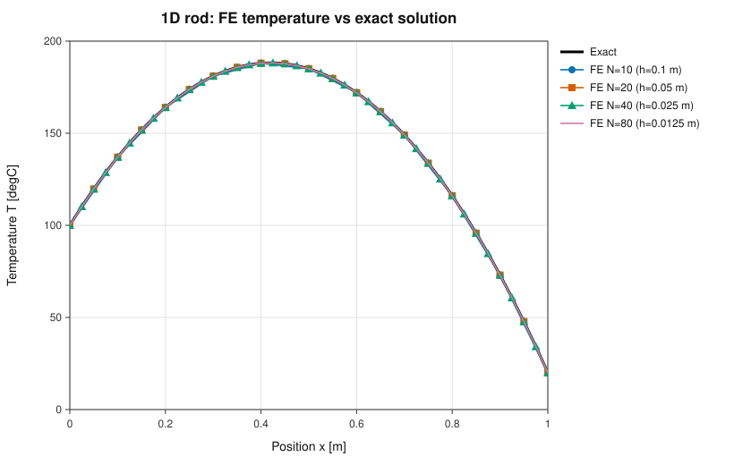
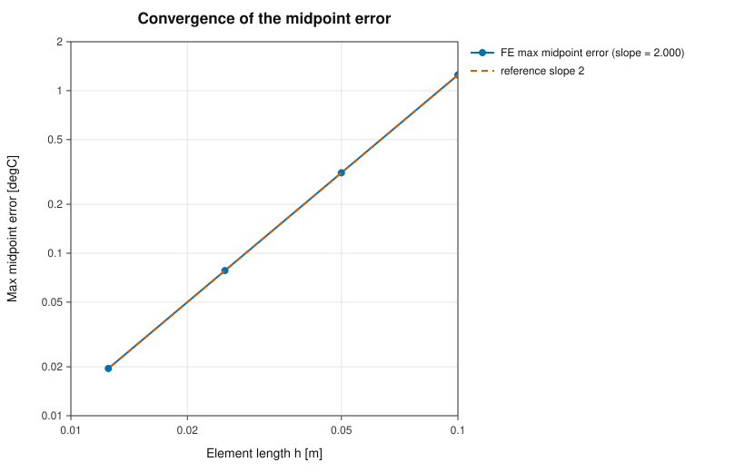
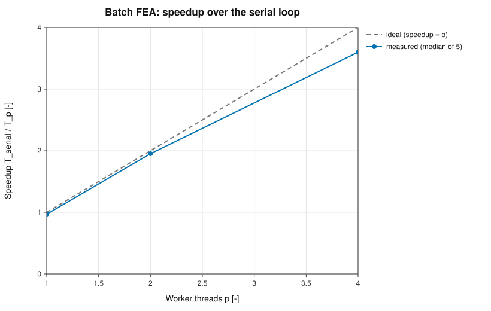
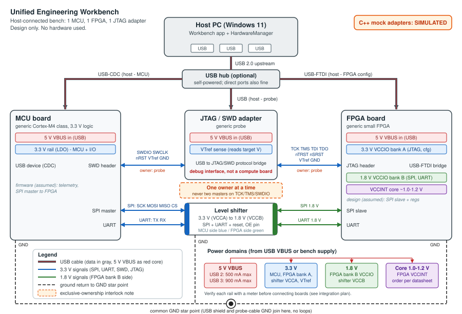
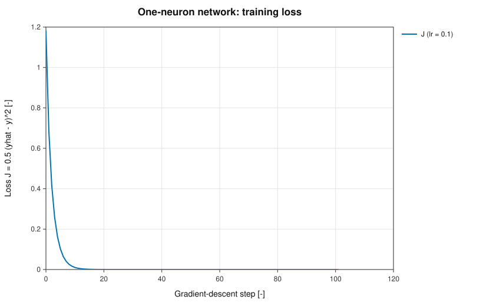

# Unified Engineering Workbench - Report

PASS Science Works R&D Internship 2026-27, Round 1

**Candidate ID:** `<CandidateID>`
**Submission ZIP:** <https://github.com/dheeraj-juvvadi/unified-engineering-workbench/releases/download/v1.0/RA2311031010070_Workbench.zip>  
**Source code:** <https://github.com/dheeraj-juvvadi/unified-engineering-workbench>

The printable version of this report is `REPORT.pdf` (generated from `report.html`, 6 pages). This Markdown file
holds the same sections in shorter form; figures are linked, not embedded.

## 1. Design and architecture

- **Layers.** `src/core` is plain C++17 (FEA, batch + worker pool, STL/CSV parsers, simulated devices, backprop,
  sysinfo) with no HTTP or JSON. `src/server` maps routes to core calls, builds JSON and runs long jobs on a
  background thread. `src/app/main.cpp` is the launcher (free port on 127.0.0.1, browser via ShellExecuteW,
  `logs/workbench.log`, heartbeat watchdog of 180 s, Origin/Host check). The UI in `web/` is plain HTML/JS with
  three.js r160 vendored.
- **Jobs.** The benchmark runs on a background thread, the page polls. A result is stored only on completion;
  Cancel gives state `cancelled` with `result: null`, never a partial result.
- **One-click delivery.** `Launch.exe` is a static C++17 executable (MinGW-w64 GCC 13 posix, `-O3 -DNDEBUG
  -static -mwindows`), 2.1 MB, importing only ADVAPI32, KERNEL32, msvcrt, SHELL32, USER32, WS2_32. Unzip and
  double-click; no admin rights, no internet. It is unsigned, so SmartScreen warns (More info, Run anyway).
- **Windows verification (real VM, not Wine).** Azure Standard_B2as_v2, Windows 11 Pro 10.0.26100, AMD EPYC 7763
  (2 logical CPUs, 1 physical core), 8 GB, non-admin user. ZIP extracted into Downloads, `Launch.exe` started via
  `explorer.exe` (same ShellExecute path as a double-click). Edge opened the app, no console window, launch-to-ready
  86.5, 56.5 and 163.8 ms in three runs (the last one cold, right after a reboot); native Linux about 1 ms. An unattended script used all five tabs and ran the benchmark; `POST
  /api/shutdown` stopped the process. The procedure was run twice (max serial/parallel difference 0 both times); data in
  `results/windows/README.md`. Screenshots: `docs/screenshots/windows/`.

## 2. Thermal FEA (Task C)

Problem: `-d/dx(k A dT/dx) = q A`, `T(0)=T0`, `T(L)=TL`. Defaults L=1 m, A=1e-4 m^2, k=10, q=1e4, T0=100, TL=20.
Exact: `T(x) = T0 + (TL-T0) x/L + q/(2k) x (L-x) = 100 - 80x + 500x(1-x)`, maximum about 188.2 degC at x = 0.42 m.

Method: N two-node linear elements, h = L/N. `Ke = (kA/h) [[1,-1],[-1,1]]`, `fe = (qAh/2) [1,1]`. Tridiagonal
global matrix; Dirichlet nodes eliminated (known values moved to the right-hand side); interior unknowns solved with the
Thomas algorithm (matrix is symmetric positive definite, no pivoting).

| N | h [m] | max nodal error [degC] | max midpoint error [degC] | q h^2 / (8k) |
|---|---|---|---|---|
| 10 | 0.1 | 2.8e-14 | 1.25 | 1.25 |
| 20 | 0.05 | 2.0e-13 | 0.3125 | 0.3125 |
| 40 | 0.025 | 8.8e-13 | 0.078125 | 0.078125 |
| 80 | 0.0125 | 1.2e-12 | 0.01953125 | 0.01953125 |

Log-log slope of the midpoint error against h: 2.000. The nodal error is machine precision (the linear-element
solution is nodally exact for this 1-D constant-coefficient problem).

**Debugging insight.** The nodal error alone (about 1e-13 for every N) looks like "zero error" and hides the O(h^2)
rate; it only shows between nodes, so midpoint errors are reported too. A test expected T(0.5) = 310 but the correct
value is 185 (q/(2k) = 500): the test was wrong, the solver right. With q = 0 the slope fit used round-off noise
(-1.46), so an error floor was added.

## 3. CAD / ANSYS-style viewer (Task B)

ASCII STL (millimetres assumed) and nodal CSV `node_id,x_m,y_m,z_m,temperature_C` (metres, degC). Strict parsers:
a file is read completely or rejected with the 1-based line number (0 = whole file) and a hint. Rejections and accepted
variations are listed in `docs/FORMATS.md`. Limits: 200 MB, 2,000,000 triangles, 5,000,000 rows.

| Input | Size | Parse time |
|---|---|---|
| STL, 200,000 triangles | 47 MB | 130 - 190 ms |
| CSV, 500,000 rows | 13.7 MB | 140 - 205 ms |
| STL, 800,000 triangles | 189 MB | about 540 ms |
| CSV, 5,000,000 rows | 155 MB | about 1.8 s |

The sample data are synthetic (`tools/gen_samples.cpp`); the CSV is not an ANSYS run (`data/PROVENANCE.md`).

## 4. Performance (Task D)

Batch of independent 1-D FEA solves, k in [1,100], q in [1e3,1e5], seed 42, 3000 cases x 5000 elements. Serial loop
versus a pool of p `std::thread` workers pulling indices from an atomic counter. 1 warm-up, 5 timed runs, median; only
the solve loop is timed. Serial and parallel results differ by at most 0 degC (limit 1e-8).

| Machine | Run | Time [s] | Speedup | Efficiency |
|---|---|---|---|---|
| Linux, Xeon 2.10 GHz, 4 logical / 4 physical, 15.7 GiB, GCC 13.3 | serial | 0.2319 | 1.00 | - |
| | 1 worker | 0.2391 | 0.97 | 97% |
| | 2 workers | 0.1188 | 1.95 | 97.6% |
| | 4 workers | 0.0644 | 3.60 | 90% |
| Windows 11 VM (run 1 / run 2), EPYC 7763, 2 logical / 1 physical, 8 GB | serial | 0.2488 / 0.2431 | 1.00 | - |
| | 1 worker | 0.2503 / 0.2501 | 0.99 / 0.97 | 99% / 97% |
| | 2 workers | 0.1635 / 0.1670 | 1.52 / 1.46 | 76% / 73% |

Analysis: the pool costs 1 to 3 percent at one worker. The batch is memory-bound (about 120 MB of results per run),
threads are started per run, and on the VM the 2 vCPUs are SMT siblings of one physical core (1.46x to 1.52x in two runs). Shared VMs add noise:
one run during compile jobs gave a 2.37x plateau at 4 workers. Another quiet run gave 4.24x (above 100 percent).
Heap tuning (`MALLOC_TRIM_THRESHOLD_`, `MALLOC_TOP_PAD_`; `results/bench_malloc_experiment.txt`) gave serial 0.1948 s
and 101.2 percent efficiency at 4 workers, so the excess came from heap trimming and page faults in the serial path,
not from real super-linear speed-up. The table is the default allocator.

## 5. Embedded design (Task E)

Design study with simulated devices; no hardware was used. Windows 11 host, one MCU (USB-CDC), one FPGA board
(USB-FTDI) and one JTAG/SWD probe. MCU 3.3 V and FPGA bank B 1.8 V are joined by a level shifter (SPI, UART);
FPGA JTAG pins are in the 3.3 V bank A, so the debug path needs no shifter; one ground star point; one JTAG master
at a time (software lock `none`/`probe`/`ftdi-config`). The probe is a protocol bridge, not a compute board.
Mock adapters (`mcu0`, `fpga0`, `jtag0`): states Disconnected/Connected/Fault, deterministic telemetry, recoverable
`TIMEOUT` then Reconnect. Details: `docs/EMBEDDED_DESIGN.md`.

## 6. Backpropagation (Task F)

`z = w x + b`, `h = tanh z`, `yhat = v h + c`, `J = 1/2 (yhat - y)^2`; x=1, y=2, lr=0.1, w=0.5, b=0, v=1, c=0.

| Quantity | Value |
|---|---|
| z, h, yhat | 0.5, 0.46211716, 0.46211716 |
| e, J | -1.53788284, 1.18254182 |
| dJ/dw = dJ/db | -1.20946448 |
| dJ/dv, dJ/dc | -0.71068205, -1.53788284 |
| max error vs central FD (eps 1e-6) | 1.1e-10 |
| after one update w, b, v, c | 0.62094645, 0.12094645, 1.07106820, 0.15378828 |
| J after one update | 0.68577377 |

Loss decreases monotonically over 100 further steps. The handwritten appendix is not included; a typed derivation is in `docs/handwritten_backprop_guide.md`.

## 7. Testing

76 tests (`wb_tests` via CTest): FEA 9, batch/benchmark 11, backprop 6, parsers 19, embedded mock 12, server and job
manager 19. Many are negative tests (malformed or oversized files, bad parameters, second benchmark while busy, cancel,
timeout and reconnect). The suite ran clean under ASan/UBSan and under TSan during development. The Windows VM run
(section 1) checks the cross-compiled executable end to end.

## 8. Limitations and next steps

- Windows x64 only, unsigned executable.
- STL ASCII only, one solid, mm assumed; the CSV layout is my own, modelled on an ANSYS export and not validated
  against a real file.
- FEA is 1-D, constant coefficients, Dirichlet ends. Next: Neumann/convective boundaries, variable k, 2-D elements.
- One benchmark problem type; results depend on the machine (the VM has one physical core).
- Hardware is simulated and the design was not tested on a bench.

## 9. AI use and ownership

AI use is disclosed in `AI_USE_LOG.md`; the ownership statement is `OWNERSHIP.md` (both in `docs/`). Third-party code is the vendored
MIT libraries in `../third_party/VERSIONS.md`.
